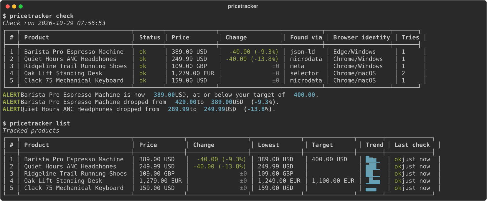
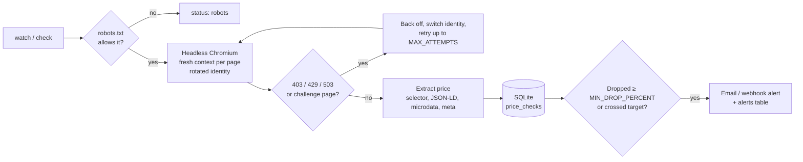

# Price Tracker Scraper

A headless-browser price tracker that checks product pages on a schedule, keeps every price in SQLite, and emails you (or posts to Slack) when a price drops.

Checking prices by hand doesn't scale, and the obvious script (`requests` plus a regex) breaks quickly on real shops. Many render prices with JavaScript, block clients that look like bots, and rate-limit repeat visitors. This tracker loads each page in **headless Chromium via Playwright** and **rotates between realistic browser identities**. It reads the price from the structured data that shops publish for Google, or from a CSS selector you give it. Every check, including failed ones, goes into SQLite. An alert fires only when a price actually changes: a drop of at least N percent, or crossing your target price.



## How it works



- **User-agent rotation.** [pricetracker/user_agents.py](pricetracker/user_agents.py) holds a pool of Chrome and Edge identities on Windows, macOS and Linux. Each one comes with a matching viewport, locale, timezone and `Accept-Language`. The pool contains only Chromium browsers, because the engine *is* Chromium, and a Firefox user agent on Chromium is an easy giveaway. Identities are handed out in a shuffled cycle, so traffic spreads evenly, and **a retry always switches identity**.
- **One fresh browser context per page.** No cookies or storage carry over between identities. Images, fonts and media are blocked to save bandwidth.
- **JavaScript prices.** After the page loads, the fetcher waits for the product's CSS selector, or for network idle, so client-side rendered prices are there before extraction.
- **Block handling.** HTTP 403/429/503, or a "verify you are human" page with no price, count as *blocked*. Those get exponential backoff with jitter and a retry under a different identity. A 404, or a page that loads fine but has no price, is not retried, because retrying wouldn't change the result.
- **Politeness.** Requests to the same site run one at a time, at least `MIN_DOMAIN_DELAY_SECONDS` apart (plus up to 50% jitter). robots.txt is honored by default.
- **Price extraction.** [pricetracker/extract.py](pricetracker/extract.py) tries a saved CSS selector, then schema.org JSON-LD (including `@graph` and `AggregateOffer`), then microdata, then Open Graph product tags. Price strings are parsed in US and European notation (`$1,299.99`, `1.299,99 €`, `1 299,50`, `CHF 1'299.00`). There is deliberately **no "grab anything that looks like a price" fallback**: that picks up shipping costs and related products, and a wrong price is worse than none because it fires false alerts.
- **History and alerts.** [pricetracker/service.py](pricetracker/service.py) stores every check with its status, price, method, browser identity and attempt count. Prices are always compared with the last *successful* check, so a blocked run in between never looks like a price change. Alerts fire on the change, not the state, so a price that stays low doesn't email you every six hours. If one alert channel fails, the others are still tried.

## Tech stack

- Python 3.12, Playwright (headless Chromium), asyncio
- Beautiful Soup 4 for extraction
- SQLite (stdlib `sqlite3`, prices as `Decimal`)
- Typer and Rich for the CLI
- SMTP email (with an `.eml` outbox fallback) and Slack-style webhooks via httpx
- Docker Compose with a bundled demo shop and [Mailpit](https://mailpit.axllent.org/) as a local inbox
- pytest and pytest-asyncio: 87 tests run without a browser, and 2 more drive real Chromium (skipped if it isn't installed)

## Run it

### Docker (recommended)

```bash
cp .env.example .env
docker compose up --build
```

This starts three containers:

- **demo-shop** on http://localhost:8080, a fake store to scrape (see [below](#the-demo-shop))
- **tracker**, which adds the demo shop's five products and checks them every 2 minutes
- **mailpit**, where alert emails arrive: http://localhost:8025

Trigger an alert by dropping a price, then wait for the next run:

```bash
curl "http://localhost:8080/admin/drop?sku=espresso-machine&percent=15"
docker compose exec tracker python -m pricetracker list
```

### Locally

```bash
python -m venv .venv
source .venv/bin/activate              # Windows: .venv\Scripts\activate
pip install -r requirements-dev.txt
playwright install chromium
cp .env.example .env

python -m demo_shop                    # terminal 1: demo shop on :8080
python -m pricetracker seed-demo       # terminal 2
python -m pricetracker check
curl "http://localhost:8080/admin/drop?sku=espresso-machine&percent=15"
python -m pricetracker check           # -> target + drop alerts
python -m pricetracker list
```

With `SMTP_HOST` left empty, alert emails are written to `outbox/` as `.eml` files.

### Tests

```bash
pytest
```

To regenerate the screenshot from a real run: `python scripts/make_screenshot.py`.

## Track a real product

```bash
python -m pricetracker add "https://example-shop.com/products/some-kettle" --target 49.99
python -m pricetracker check 1
```

If the check comes back `no_price`, the page has no structured price data. Open it in your browser, inspect the price element, and save a selector:

```bash
python -m pricetracker set 1 --selector ".product-price .current"
```

Then leave it running on a schedule:

```bash
python -m pricetracker watch --every 6h
```

Before tracking a site, check its terms of service. Keep the interval long: a price that changes daily doesn't need checking every minute.

## CLI

| Command | What it does |
| --- | --- |
| `add URL [--name] [--target] [--selector]` | Start tracking a page |
| `set ID [--name] [--target] [--selector] [--pause] [--resume]` | Change a product; use `none` to clear a target or selector |
| `remove ID` | Stop tracking and delete its history |
| `list` | Latest price, change, lowest seen, target, trend sparkline, last check status |
| `check [ID...]` | Check now and print a run report and any alerts |
| `history ID [--limit]` | Every check, including failures, with the browser identity used |
| `alerts` | Recent alerts |
| `watch --every 6h` | Check on a schedule (±10% jitter) until stopped |
| `seed-demo [--base-url]` | Track the demo shop's products |

Add `-v` before the command (`python -m pricetracker -v check`) to log every attempt, including blocks and identity switches.

## The demo shop

[demo_shop/server.py](demo_shop/server.py) is a small stdlib HTTP server, included so the project can be demoed and tested without scraping real retailers. Each product uses a different markup style:

| Product | Markup | What it exercises |
| --- | --- | --- |
| Espresso machine | JSON-LD | the most common case; has a target price |
| Headphones | microdata | `itemprop="price"` |
| Trail shoes | Open Graph meta | GBP prices |
| Standing desk | plain HTML, `1.249,00 €` | needs a CSS selector, European format, a decoy "was" price |
| Keyboard | price rendered by JavaScript | why a real browser is needed |

It also behaves like a lightly protected shop. Requests whose user agent contains `HeadlessChrome` (Playwright's default) get a 403. A share of product requests (`--block-rate`, default 15%) get a 429. `/admin/requests` shows the user agent of each recent request, so you can see the rotation. `/admin/set-price?sku=…&price=…` and `/admin/drop?sku=…&percent=…` change prices.

## Configuration

All settings come from environment variables or `.env`. See [.env.example](.env.example).

| Variable | Default | Purpose |
| --- | --- | --- |
| `DB_PATH` | `data/prices.db` | SQLite file |
| `DEFAULT_CURRENCY` | `USD` | Used when a page shows a price but no currency |
| `HEADLESS` | `true` | Set `false` to watch the browser work |
| `PAGE_TIMEOUT_SECONDS` | `30` | Page load timeout |
| `MAX_ATTEMPTS` | `3` | Tries per product per run (each with a new identity) |
| `CONCURRENCY` | `3` | Products checked in parallel (different sites only) |
| `MIN_DOMAIN_DELAY_SECONDS` | `2` | Minimum gap between requests to one site |
| `RESPECT_ROBOTS_TXT` | `true` | Skip pages robots.txt disallows |
| `MIN_DROP_PERCENT` | `1` | Smallest drop that sends an alert |
| `ALERT_EMAIL_TO` / `FROM_EMAIL` | empty / `price-tracker@localhost` | Email alerts; empty recipient turns them off |
| `ALERT_WEBHOOK_URL` | empty | Slack-style webhook, posts `{"text": ...}` |
| `SMTP_HOST`, `SMTP_PORT`, `SMTP_USER`, `SMTP_PASSWORD`, `SMTP_STARTTLS` | empty / 587 / on | SMTP server; empty host writes to `outbox/` |

## Limitations

- User-agent rotation gets past simple user-agent checks and per-identity rate limits, like the demo shop's. It won't beat serious bot protection (Cloudflare, DataDome, Akamai). Those look at TLS fingerprints, `navigator.webdriver`, IP reputation and behavior. Getting past them takes residential proxies or a scraping API, which this project doesn't include.
- All requests come from one IP address. Rotating identities doesn't hide that.
- The `watch` loop runs in one process. For many products or several machines, put the checks on a job queue (see project #20, `scraping-job-scheduler`).
- CSS selectors break when a shop redesigns. Structured data is far more stable, so the selector is only the first choice when you set one.
- The SQLite file is fine for thousands of products and one writer. It isn't meant for concurrent writers.

All products and prices in the demo shop are made up.

## sort entries

Updated implementation details.

## warm cache

Updated implementation details.

## init service

Updated implementation details.

## sort entries

Updated implementation details.

## warm cache

Updated implementation details.

## init service

Updated implementation details.